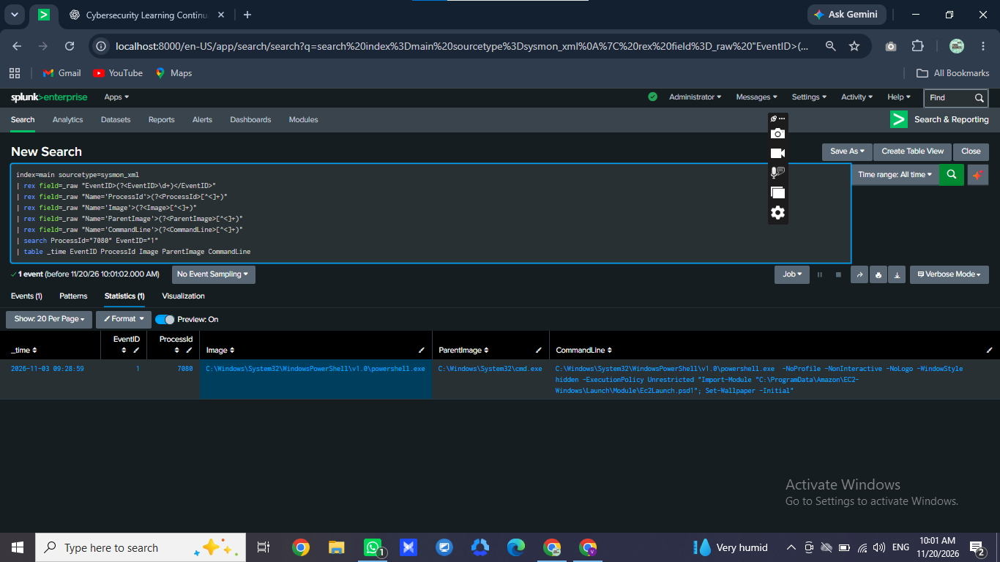
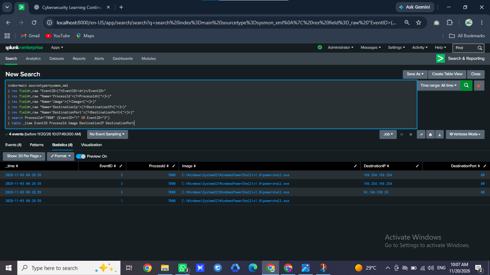
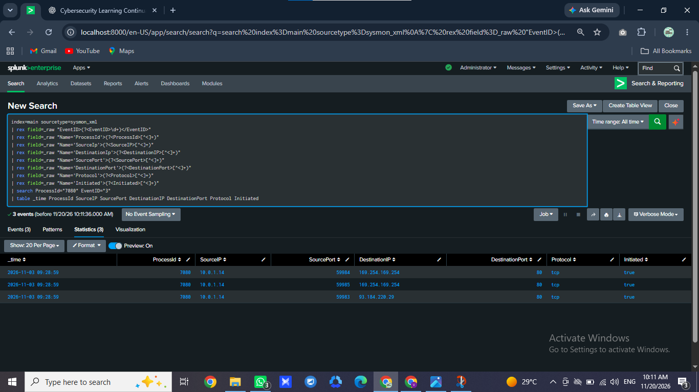
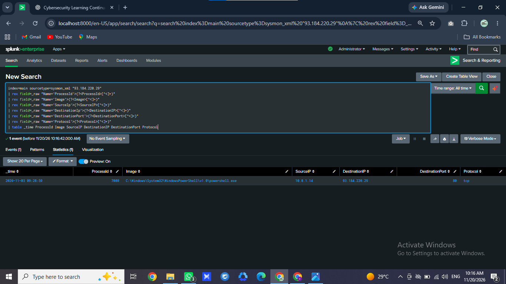
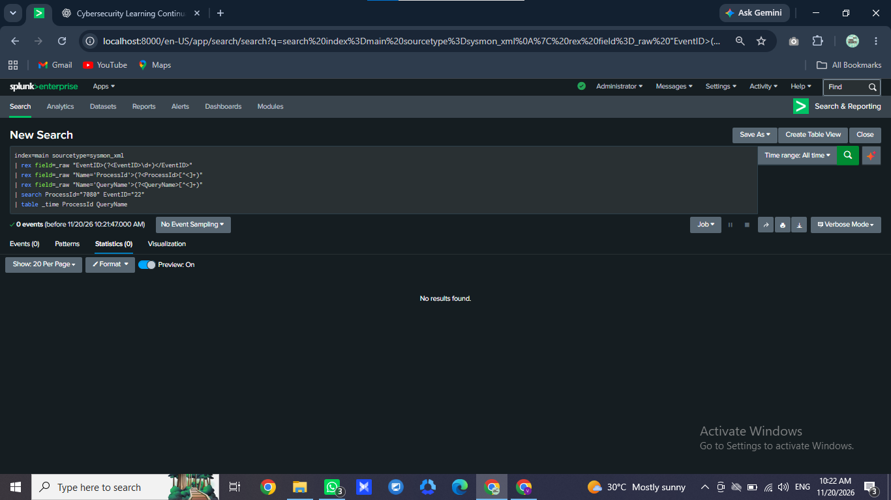

# Splunk Sysmon Security Investigation

## 1. Project Overview

This project documents a security investigation conducted using **Splunk Enterprise** and Sysmon XML event logs.

The investigation focuses on a PowerShell process (Process ID `7080`), its process-creation activity, associated network connections, an external destination, and a DNS-query investigation.

The objective was to demonstrate how a Security Operations Centre (SOC) analyst can use endpoint telemetry and Splunk Search Processing Language (SPL) to investigate potentially suspicious activity.

## 2. Tools and Technologies

- Splunk Enterprise
- Sysmon
- Windows Event Telemetry
- Search Processing Language (SPL)

## 3. Investigation Scope

The investigation examined three Sysmon event types:

| Event ID | Description | Investigation purpose |
|---|---|---|
| 1 | Process Creation | Examine PowerShell execution |
| 3 | Network Connection | Identify network activity associated with the process |
| 22 | DNS Query | Search for related DNS activity |

## 4. Investigation and Evidence

### 4.1 PowerShell Process Creation

**Evidence:** `01-process-creation.png`



The investigation identified a Sysmon Event ID 1 associated with:

- Process: `powershell.exe`
- Process ID: `7080`
- Parent process: `cmd.exe`

The displayed command line included options such as `-NoProfile`, `-NonInteractive`, `-NoLogo`, `-WindowStyle hidden`, and `-ExecutionPolicy Unrestricted`.

These options can be used in legitimate automation, but they also warrant examination in a security investigation.

**SPL search:**

```spl
index=main sourcetype=sysmon_xml
| rex field=_raw "<EventID>(?<EventID>\d+)</EventID>"
| rex field=_raw "Name=\"ProcessId\">(?<ProcessId>[^<]+)"
| search ProcessId="7080" EventID="1"
| table _time EventID ProcessId
```

### 4.2 Network Connections

**Evidence:** `02-network-connections.png`



Three network-connection events were identified for Process ID `7080`.

The results included connections to:

- `169.254.169.254`
- `93.184.220.29`

**SPL search:**

```spl
index=main sourcetype=sysmon_xml
| rex field=_raw "<EventID>(?<EventID>\d+)</EventID>"
| rex field=_raw "Name=\"ProcessId\">(?<ProcessId>[^<]+)"
| search ProcessId="7080" EventID="3"
| table _time EventID ProcessId
```

### 4.3 Network Connection Details

**Evidence:** `03-network-details.png`



The extracted network information showed:

| Source IP | Source port | Destination IP | Destination port | Protocol |
|---|---:|---|---:|---|
| 10.0.1.14 | 59984 | 169.254.169.254 | 80 | TCP |
| 10.0.1.14 | 59985 | 169.254.169.254 | 80 | TCP |
| 10.0.1.14 | 59983 | 93.184.220.29 | 80 | TCP |

All three records showed initiated connections.

### 4.4 External Destination Investigation

**Evidence:** `04-external-destination.png`



A focused search for `93.184.220.29` returned one matching network event associated with PowerShell process `7080`.

The connection originated from `10.0.1.14` and used TCP port `80`.

**SPL search:**

```spl
index=main sourcetype=sysmon_xml "93.184.220.29"
| table _time _raw
```

The presence of an external IP address does not independently establish malicious activity. Further investigation and corroborating evidence would be required.

### 4.5 DNS Investigation

**Evidence:** `05-dns-investigation.png`



A search for Sysmon Event ID `22`, associated with Process ID `7080`, returned zero matching events.

**SPL search:**

```spl
index=main sourcetype=sysmon_xml
| rex field=_raw "<EventID>(?<EventID>\d+)</EventID>"
| rex field=_raw "Name=\"ProcessId\">(?<ProcessId>[^<]+)"
| search ProcessId="7080" EventID="22"
| table _time EventID ProcessId
```

This indicates that no matching DNS-query event was found in the searched telemetry. It does not prove that DNS activity never occurred.

## 5. Key Findings

1. PowerShell process `7080` was created with `cmd.exe` as its parent process.
2. The recorded command line included hidden and non-interactive execution options.
3. Three network-connection events were associated with the process.
4. One connection targeted `93.184.220.29` over TCP port `80`.
5. The DNS Event ID 22 search returned no matching events.

## 6. Security Assessment

The observed activity warrants further investigation, particularly the PowerShell execution context and its associated network connections.

However, the available evidence does not independently establish malware execution, command-and-control activity, data exfiltration, or system compromise.

The appropriate assessment is **activity requiring further investigation**.

## 7. Data Quality and Limitations

A timestamp discrepancy was observed:

- Splunk displayed event time: `2026-11-03 09:28:59`.
- Raw XML records displayed a `SystemTime` value dated `2020-11-10`.

Timestamp extraction, timezone handling, and ingestion configuration should be validated before establishing a definitive event timeline.

The investigation is also limited to the events and fields visible in the collected evidence.

## 8. Recommendations

- Validate whether the PowerShell execution was expected administrative or EC2Launch activity.
- Review the complete raw Sysmon records and available process metadata.
- Correlate endpoint, firewall, proxy, and DNS logs.
- Review the destination IP using trusted threat-intelligence sources.
- Validate timestamp extraction and timezone configuration.
- Continue investigating using process GUIDs and additional host telemetry where available.

## 9. Conclusion

This project demonstrates a practical Splunk-based security investigation involving process creation, network activity, external destination analysis, and DNS-event searching.

It highlights the importance of correlating endpoint and network telemetry, documenting evidence, and avoiding conclusions that are not supported by available data.

## 10. Repository Structure

```text
splunk-sysmon-investigation/
├── README.md
├── evidence/
│   ├── 01-process-creation.png
│   ├── 02-network-connections.png
│   ├── 03-network-details.png
│   ├── 04-external-destination.png
│   └── 05-dns-investigation.png
└── reports/
    ├── Splunk_Security_Investigation_Report.docx
    └── Splunk_Security_Investigation_Report.pdf
```

---

**Project type:** Defensive Cybersecurity / SIEM Investigation  
**Platform:** Splunk Enterprise  
**Telemetry:** Sysmon  
**Focus:** Windows Process and Network Activity
